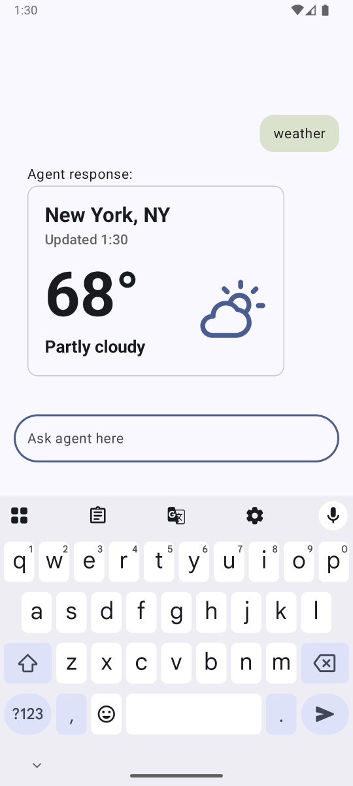
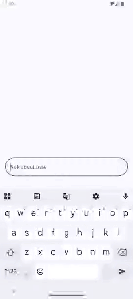
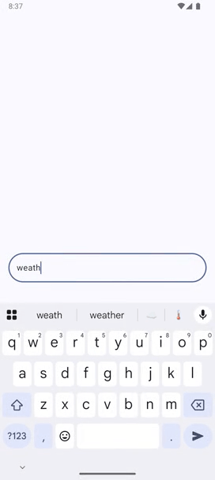

## Project

In this repo I experiment with AI on the client side. First up is dynamic UI in
agentic chats via Agent-to-UI (A2UI) protocol. Local GenAI next.

## Dynamic Agentic UI

### Background

A2UI is a protocol that lets chat agents dynamically include native UI components in their responses.
Replacing walls of text with native, structured UI makes agentic chats more compelling to interact
with and easier to read.

Agents stream [JSON Lines](https://jsonlines.org/), which the client can render progressively to
show results as they come in, minimizing wait time for users. You can read about it and see more
examples in Google's [Agent-to-UI for Compose](https://developer.android.com/develop/ui/compose/agentic)
docs. The docs' demo shows what A2UI can look like with instant rendering and fast agent responses.
Real agents are slower, which is where progressive rendering comes into play.

### Result

Here's A2UI in action in this project – a native Weather Card rendered progressively from a
mocked agent response.

 

### Approach

The goal was to learn how A2UI works under the hood, so I built it incrementally and without
AI code generation.

I started with the chat UI – a simple "echo" command where a fake agent repeats the user's
message. Then I layered in A2UI features, starting from a single A2UI `Surface` to understand
what it really is, how it's rendered, who renders it, when it gets rendered, and how data gets
passed in. From there, I explored adding multiple `Surface`s and associating them to the right
chat messages.

With the fundamentals locked in, I built a Weather Card – both from default components and a
custom one, each backed by a fake agent simulating A2UI messages as an agent would.

Testing how well an agent performs in real world conditions will be the next step.

### Learnings

#### Basic/Default A2UI components

These are standard, out-of-the-box UI components – things like Text, Image, Icon, and Column/Row for
layouts. The upside is they provide flexibility over what information to show and how to arrange it.

But there are downsides. For one, styling is limited. The basic components don't allow custom
padding by design, which makes design difficult. Text sizes are also limited to about five presets.

The second is it can lead to an inconsistent experience. Building block components like this provide
too much arrangement flexibility. An agent could lay out the weather card differently each time.

Here's the Weather Card rendered dynamically with default components. It gets the job done,
but you'll see it lacks visual identity and padding can't be controlled.

#### Custom A2UI components

You get full control over spacing and typography, as well as consistent visual design. The tradeoff
is that new components require a mobile app release. That said, the higher, more consistent quality
seems worth it.

#### Conclusion

Custom components are the better option for production apps. The basic components are great
for rapid prototyping.